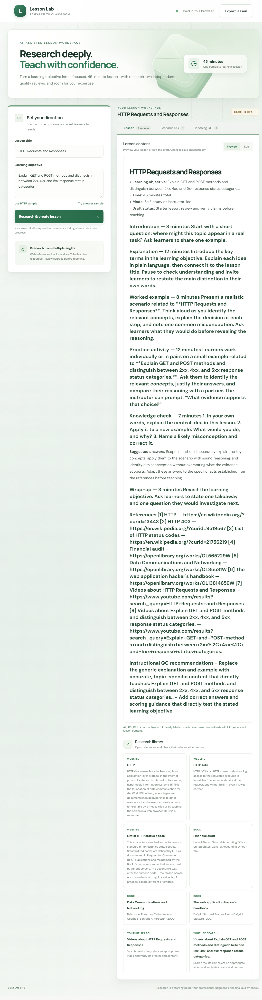
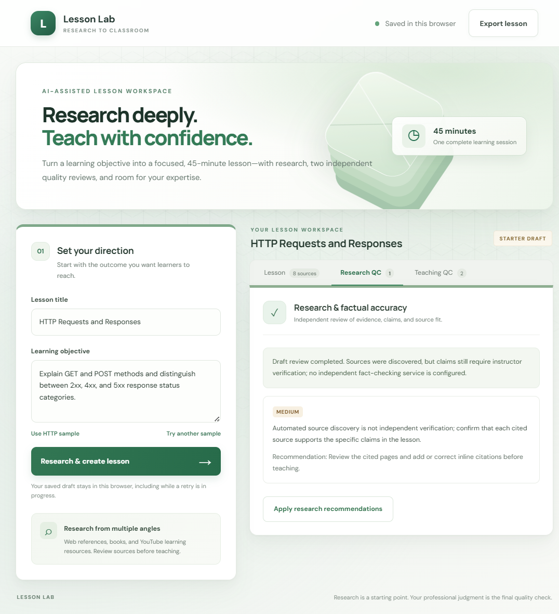
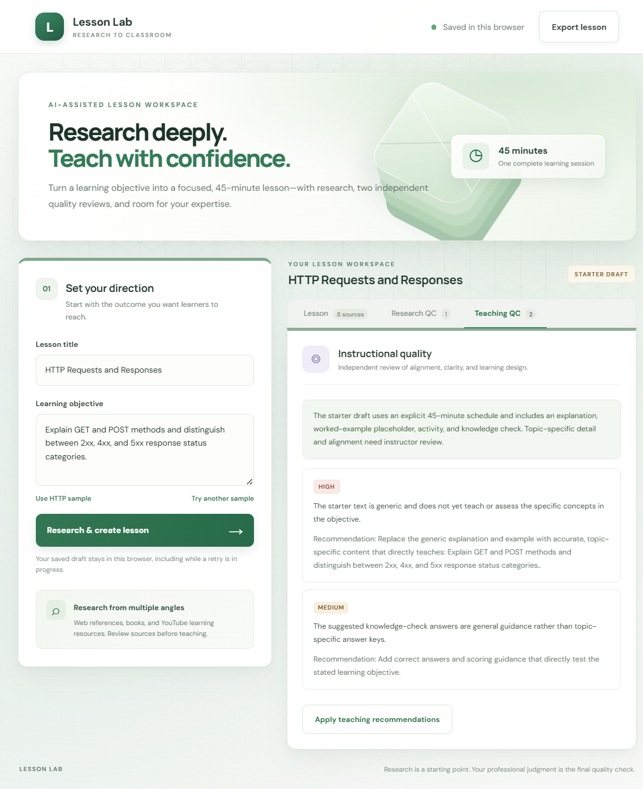

# Lesson Lab

A locally run lesson-creation workspace for researching sources, drafting a 45-minute lesson, reviewing two separate quality-control reports, editing, previewing, and exporting.

## Run from this repository

Requires Node.js 20 or newer. Clone this repository and run:

```powershell
npm start
```

Open `http://localhost:3000`. To run tests, use `npm test`.

Without an AI provider key, the app clearly labels its output as a generic starter lesson. For topic-specific generation and separate AI quality audits, set `AI_API_KEY` before starting the server. Optional `YOUTUBE_API_KEY` enables video candidates. See the project ZIP for complete setup details.

## Project files

- `server.js` serves the app and research API.
- `lesson.js` contains lesson prompts, starter content, and validation.
- `public/` contains the browser interface and styles.
- `test/` contains the automated tests.
- [Download the complete project ZIP](./Lesson-Lab-Project.zip).

## Screenshots

These are screenshots of starter mode, clearly labeled as drafts because no AI provider key was configured when captured.

### Lesson preview and research library



### Research and factual accuracy review



### Instructional quality review


